<div align="center">

# 🌾 FoodFlow — From Every Harvest to Every Table

**A farm-to-table marketplace where a farmer with a basic phone, in Kannada or Hindi, gets the same market as anyone else.**

Farmers sell straight to households, restaurants and community kitchens. **Sakhi** (ಸಖಿ / सखी), the farmer's
voice companion, takes them from sign-up to first sale by voice, and **phones them about every order**, so
even a farmer without a smartphone never misses a sale.

[](https://github.com/RachanaB5/SAKHI-Every-Farmer-Deserves-an-Opportunity./actions/workflows/ci.yml)


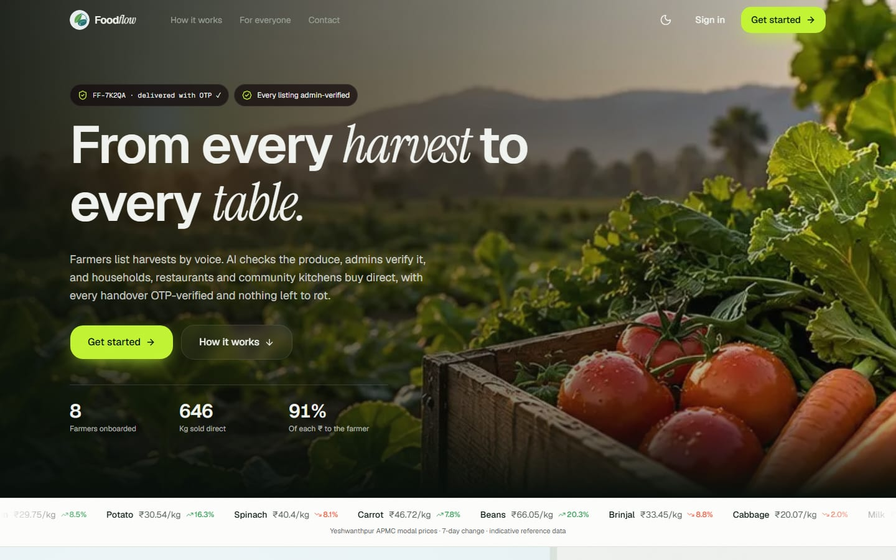

[Why](#-why-foodflow-exists) · [What](#-what-foodflow-does) · [SDG 10](#-built-for-sdg-10-reduced-inequalities) · [Sakhi](#-sakhi-a-voice-companion-in-the-farmers-language) · [Gram Panchayat partners](#-gram-panchayat-saathi-the-last-mile-is-a-person) · [Business model](#-business-model) · [Try it](#-try-it-in-two-minutes) · [Architecture](#-architecture) · [Tech stack](#-tech-stack) · [Roadmap](#-roadmap)

</div>

---

## ⚡ The 30-second pitch

| | |
| --- | --- |
| **Why** | Smallholder farmers earn a fraction of what buyers pay, lose produce that doesn't sell in time, and are shut out of digital markets by language, literacy and devices. |
| **What** | One marketplace, five apps: farmers, households, restaurants & community kitchens, delivery riders and operations. Fair prices, verified quality, OTP-confirmed delivery, transparent payouts. |
| **How** | Voice-first in Kannada, Hindi and English; an automated phone call for every order; AI that assists while people decide; and a trusted local partner in every Gram Panchayat who signs farmers up and earns for it. |
| **Money** | A 5% commission withheld from the farmer's payout (admin-adjustable), delivery fees paid by buyers, and bulk procurement for restaurants. The farmer keeps at least 80% of the produce price, and usually 95%. |
| **Impact** | Built for **SDG 10 — Reduced Inequalities**: income growth for the bottom earners (10.1) and economic inclusion regardless of language, literacy or device (10.2). |

---

## 🧭 Why FoodFlow exists

- **Farmers get a small share of the consumer rupee.** An RBI study (2024) found farmers receive roughly a
  third of what consumers pay for tomatoes, onions and potatoes; the rest goes to the chain in between.
- **Food is lost before it is sold.** NABCONS (2022) estimated India's post-harvest losses at about ₹1.5 lakh
  crore a year. Perishables that don't sell in time simply rot.
- **Most farmers are small.** About 86% of India's farmers are small or marginal (Agriculture Census 2015–16).
  They can't negotiate with large buyers on their own.
- **Digital markets assume English, literacy and a smartphone.** A farmer who speaks only Kannada, reads
  little, or has a feature phone is left out of every app built that way.
- **Buyers lose too.** Households pay retail markups for produce that is days old, restaurants juggle
  unreliable suppliers, and community kitchens that feed people for free struggle to source affordably.

**Who we build for** (all seeded in the demo):

| Persona | Need | What FoodFlow gives them |
| --- | --- | --- |
| **Ramesh Gowda**, tomato farmer, Doddaballapur | Sell 200 kg a week at a fair price; speaks Kannada | List by voice, a phone call for each order, payouts he can trace rupee by rupee |
| **Ananya Rao**, household, Yelahanka | Fresh vegetables without the markup | Snap a grocery list → smart basket from nearby farms → doorstep delivery |
| **The Green Ladle**, restaurant, Hebbal | 50 kg of onions by tomorrow, every week | Post a demand; nearby farmers offer; offers ranked and explained |
| **Annapurna Community Kitchen** | Affordable bulk produce | Surplus rescue: produce at risk of waste offered at their target price |
| **Gram Panchayat Saathi** (planned) | Local income, helping neighbours | Assisted farmer sign-up, with an incentive per active farmer |

---

## 🛒 What FoodFlow does

One marketplace, five apps, each built mobile-first at **360 px** and scaling up to a full desktop web app.
The whole site switches to **Kannada** automatically for visitors in Karnataka (to **Hindi** in Hindi-speaking
states), with a language menu in every top bar.

| App | Who | Highlights |
| --- | --- | --- |
| 🧑‍🌾 **Farmer** | Smallholders | List a harvest **by voice**; a **Gemini photo check** (is it really tomatoes? how fresh?) that says *not detectable* instead of guessing and never marks down a cheap phone's photo; grades that **follow customer reviews**; indicative **mandi price advice**; orders, bulk offers, **surplus rescue**, traceable payouts; a **phone call for every order**. |
| 🏠 **Household** | Consumers | **Snap or type a grocery list → smart basket** across nearby farms; per-farm delivery; live tracking; **OTP doorstep handover**; **subscriptions** (milk every morning, vegetables every Sunday). |
| 🍽️ **Restaurant / community kitchen** | Bulk buyers | Post urgent or recurring demand by form, voice or a procurement list; nearby farmers offer from live stock; **offers ranked** on cost, quantity, ETA, quality, distance and reliability, with the reason; counter-offers; invoices. |
| 🛡️ **Admin** | Operations | A **human verification queue** for every harvest (AI flags, duplicate-photo detection, EXIF capture time); disputes and refunds; trust & safety; platform controls; live analytics. |
| 🛵 **Delivery** | Riders | Today's runs; find an order by code, QR or voice; a delivery is complete **only when the customer's OTP** is entered. |

---

## 🎯 Built for SDG 10: Reduced Inequalities

Digital commerce widens inequality when it only works for people who read English and own smartphones.
Each FoodFlow feature removes one of those barriers:

| Barrier | What FoodFlow does | SDG target |
| --- | --- | --- |
| **No smartphone** | An automated **phone call for every order** on any phone; the farmer answers by speaking or pressing a key | 10.2 |
| **Language** | Every screen in English, हिन्दी and ಕನ್ನಡ, switched automatically by location; Sakhi speaks and understands all three, including mixed speech | 10.2 |
| **Literacy** | Sign-up, listing a harvest and checking earnings **by voice**; Sakhi reads every question aloud and fills the form | 10.2 |
| **Cheap cameras** | Photo checks judge the produce, not the photography; a blurry or dark photo never lowers a score | 10.3 |
| **Middlemen's margin** | Direct sales: the farmer keeps 80–95% of the produce price, against roughly a third through traditional chains | 10.1 |
| **Unsold produce** | Surplus rescue offers at-risk lots to community kitchens, never below 70% of the mandi rate | 10.1 |
| **Trust gap with big buyers** | Restaurants rank offers on reliability and verified quality, so a small farmer competes on merit | 10.3 |
| **Opaque payments** | Every order shows value, commission and net payout; payouts release only after an OTP-confirmed handover | 10.3 |
| **No one to ask** | A Gram Panchayat Saathi (planned) helps farmers sign up and earns for it | 10.2 |

*10.1: income growth of the bottom 40% · 10.2: social and economic inclusion of all · 10.3: equal opportunity and reduced inequality of outcome.*

---

## 🗣️ Sakhi: a voice companion in the farmer's language

A sprout button on every farmer screen opens Sakhi. Farmers speak or type in Kannada, Hindi, English or a mix:

- *"ಐವತ್ತು ಕಿಲೋ ಟೊಮೇಟೊ, ಕಿಲೋಗೆ ಇಪ್ಪತ್ತೈದು ರೂಪಾಯಿ"* → a harvest draft, ready for a photo and review
- *"इस हफ्ते मैंने कितना कमाया?"* → order value, fee, estimated net, and what's paid vs. pending
- *"tomato price 32 karo"*, *"show restaurant orders"*, *"book delivery for FF-ABC12"*, *"my payments"*

**From sign-up to first listing, hands-free.** On seller sign-up Sakhi asks every question aloud and fills
the form from the answers (*"ನನ್ನ ಹೆಸರು ರಮೇಶ್"*, *"ದೊಡ್ಡಬಳ್ಳಾಪುರ"*, *"UPI and cash"*); the PIN is typed,
never spoken. Then, in the farmer app: the harvest, a photo, *"send it for review?"*, *"ಹೌದು"*.

How it stays trustworthy:

- **Rules first, model second.** A parser for spoken numbers (*sava do sau*, *ಎರಡೂವರೆ ಸಾವಿರ*), units, crops
  and dates in all three languages handles most requests; Gemini is asked only when the rules are unsure,
  returns a schema-checked intent, and never touches the database.
- **Nothing changes without a confirmation.** Publishing, prices, stock, offers and deliveries show a card first;
  confirmations are signed, tied to the farmer, single-use and expire in five minutes.
- **Understands people, not just options.** Shortcuts and slips (*"rest"*, *"the 2nd one"*, *"gpay and cash"*),
  dozens of ways to say yes and no (*"ಆಯ್ತು"*, *"हाँ जी"*), and real answers to *"what is this app?"*,
  *"ಇದು ಉಚಿತವಾ?"*, *"पैसे कब मिलेंगे?"*.
- **A real Kannada and Hindi voice.** Most browsers have no Kannada voice, so FoodFlow speaks it itself:
  SYSPIN's open voices from IISc Bangalore (CC BY 4.0), converted to ONNX and run on the server.
  Amounts are read the Indian way (*1 lakh 25 thousand*, *ಎರಡು ಸಾವಿರದ ಐನೂರು*).

What happens to voice and text: [docs/assistant-privacy.md](docs/assistant-privacy.md).

### 📞 A phone call for every order

When an order is confirmed, Sakhi rings the farmer:

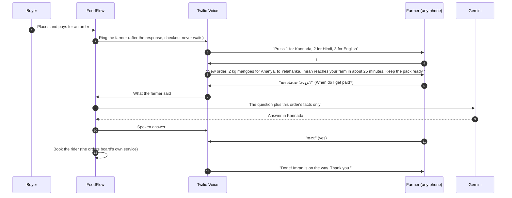

- **Yes** (or pressing 1) books the rider; **no** leaves the order unchanged and flags it for the team; silence gets one gentle re-prompt.
- Voices are Google WaveNet (Kannada, Hindi, Indian English). Gemini answers only from the order's facts, and Sakhi's FAQ answers when Gemini is unavailable.
- Each call's webhook URL carries a per-order HMAC key. The farmer's board has **Call me about this order** to hear it again.

### 🤖 AI assists. People decide.

- **Visual checks, not certificates.** Scores describe what's visible in photos, never food safety.
- **No guessing.** If photos can't be graded (not produce, unclear, a stock photo, the wrong crop, or eggs, milk or chicken), the result is *not detectable* with the reason.
- **Customers keep grades honest.** Photos set the starting grade; buyer reviews move it after that, and one buyer alone can't change it.
- **Prices are indicative.** Numbers come from mandi references and comparable listings; the model only rewords the explanation. The farmer sets the price.
- **People approve listings.** AI flags help the admin; a person decides what goes live.
- **OTP or it didn't happen.** Only the customer's one-time code marks an order delivered and releases a payout.
- **Works without a key.** Every AI feature has a deterministic fallback, labelled *Offline estimate*.

---

## 🤝 Gram Panchayat Saathi: the last mile is a person

> **Status: rollout model (planned).** The app already supports everything a Saathi needs to help a farmer
> (voice-guided sign-up, voice listing, order calls). The partner dashboard and incentive ledger are on the
> [roadmap](#-roadmap).

Technology alone doesn't reach the last farmer; a trusted neighbour does. In every Gram Panchayat, FoodFlow
appoints one **Saathi** (companion): a local person farmers already know. Good candidates are a self-help
group member or Krishi Sakhi, a Common Service Centre operator, or a Panchayat volunteer.

**What a Saathi does**

| Responsibility | How |
| --- | --- |
| **Sign farmers up** | Sits with the farmer and completes sign-up with Sakhi in the farmer's language; the farmer's own mobile receives the verification code, so every account belongs to a real person |
| **First listing** | Helps take the first harvest photos and send the batch for review |
| **Village collection point** | Coordinates a pickup spot and time, so riders do one stop for several farms |
| **Trust on the ground** | Confirms identity and farm location, and is the first contact for disputes |
| **Training** | Shows farmers how to answer Sakhi's order calls and check their payouts |

**How a Saathi earns** (proposed; paid out of FoodFlow's commission, never deducted from farmers):

| Incentive | Amount | Paid when |
| --- | --- | --- |
| **Activation bonus** | ₹100 per farmer | That farmer completes **3 OTP-verified deliveries** (no payment for empty sign-ups) |
| **Revenue share** | **1 percentage point** of FoodFlow's 5% commission on those farmers' sales | For the first 12 months |
| **Quality bonus** | ₹500 a month | The Saathi's farmers keep complaint rates below the platform average |

*Example: a Saathi with 40 active farmers each selling ₹15,000 a month generates ₹6 lakh in sales, so ₹6,000
a month in revenue share, a meaningful income in a village, earned by helping neighbours sell.*

**Safeguards.** Incentives are paid only on OTP-verified deliveries to independent buyers. The existing trust
engine (duplicate photos, complaint rates, price outliers) also covers a Saathi's farmers. Every account is
tied to a verified mobile number, and payouts are audit-logged.

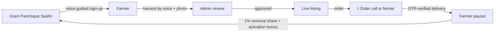

---

## 💰 Business model

**Revenue streams**

| Stream | How it works | Status |
| --- | --- | --- |
| **Commission** | 5% of the produce value, withheld from the farmer's payout (admin-adjustable in Controls) | ✅ Live |
| **Delivery fee** | Buyers pay a per-area delivery fee; retail delivery is free from ₹499. Courier cost is ₹15 + ₹1.5/km, capped at ₹60 | ✅ Live |
| **Bulk procurement** | Restaurants and kitchens buy through ranked offers; the same commission applies | ✅ Live |
| **Subscriptions** | Recurring household orders (milk daily, vegetables weekly) for predictable volume | ✅ Live (payments simulated; UPI AutoPay planned) |
| **Restaurant Pro** | Recurring schedules, invoices and procurement analytics as a paid tier for kitchens | 🔜 Planned |
| **Logistics partners** | Village collection points that batch pickups, cutting cost per kg | 🔜 Planned |

**Where a ₹1,000 order's money goes**

| | Amount |
| --- | --- |
| Produce value paid by the buyer | ₹1,000 |
| FoodFlow commission (5%) | − ₹50 |
| Farmer's share of delivery, if the buyer's fee doesn't cover the courier (capped at 15% of the order, usually ₹0) | − ₹0 to ₹150 |
| **Farmer receives** | **₹800 to ₹950**, against roughly a third of the consumer price through a traditional chain |

**Why buyers come:** fresher produce (harvest age is shown on every listing), lower prices than retail,
verified quality with OTP-confirmed delivery, and for restaurants, competing offers ranked and explained.

**Metrics we track** (live on the admin dashboard): GMV, orders, fulfilment rate, farmer earnings, kg sold,
**kg rescued from waste**, and average buyer rating.

**Go-to-market**

1. **Pilot: Bengaluru.** Farms in Doddaballapur and Bengaluru Rural selling into Yelahanka, Hebbal and
   Jayanagar households, restaurants and community kitchens (the seeded demo).
2. **Saathi network.** Five Gram Panchayats around Doddaballapur, one Saathi each, onboarding farmers in person.
3. **Scale out.** Farmer producer organisations (FPOs) bring members in bulk. Hindi is already built, so
   Hindi-speaking states follow, with more languages after that.

---

## 📸 Screenshots

| | |
| --- | --- |
| 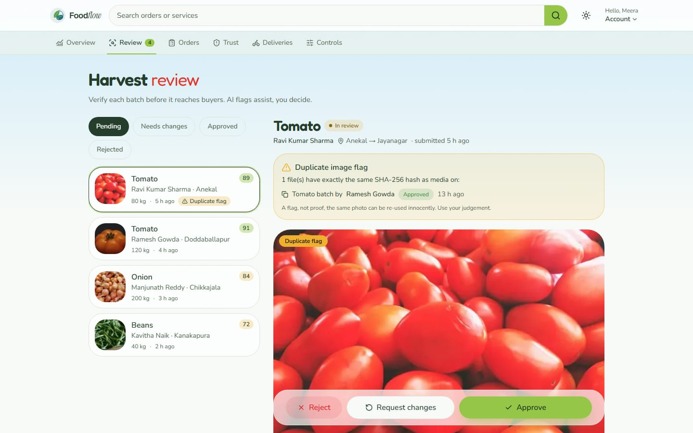 | 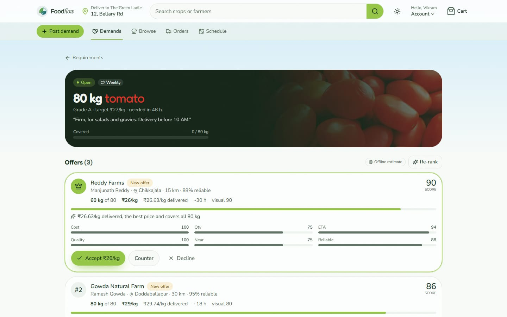 |
| Admin review: a re-used photo is flagged; the admin decides | Bulk demand: offers ranked with the reason and every factor |
| 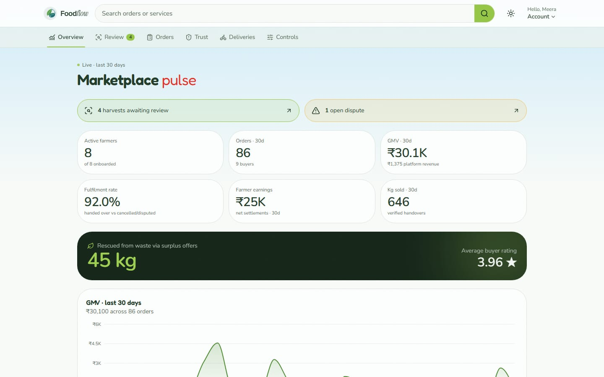 | 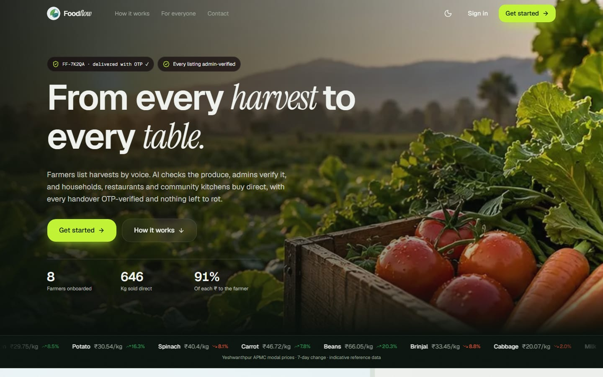 |
| Live marketplace analytics | Dark mode |

<p>
  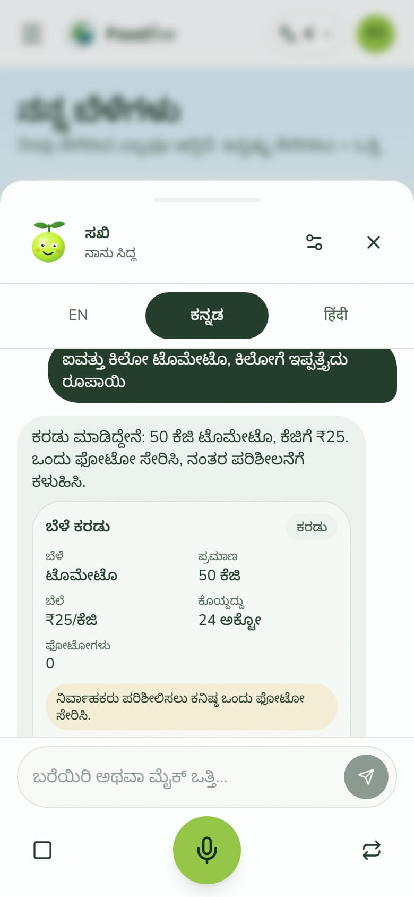
  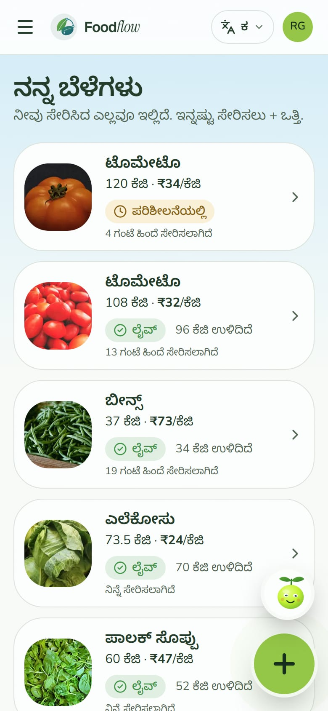
  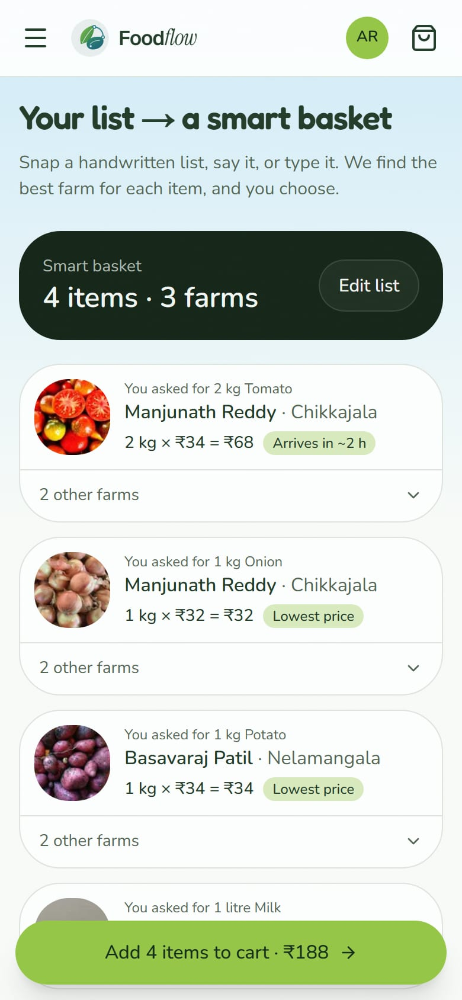
  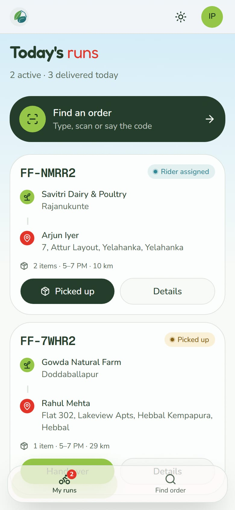
</p>

*Sakhi drafting a harvest from a Kannada sentence · farmer home in Kannada · a grocery list turned into a smart basket · the rider's run screen.*

---

## 🚀 Try it in two minutes

**You need:** Node.js **20.9+**. Everything else is optional: a Gemini key, Twilio, Razorpay test keys, Firebase,
and Python 3.10+ (only to build the server-side Kannada/Hindi voices, see [`requirements.txt`](requirements.txt)).

```bash
git clone https://github.com/RachanaB5/SAKHI-Every-Farmer-Deserves-an-Opportunity..git foodflow
cd foodflow
npm install
npm run setup   # creates .env, builds the SQLite database, seeds the Bengaluru pilot
npm run dev
```

Open **http://localhost:3000** and press **Get started**, or sign in at `/login` → *I already have an account*
with a seeded number and PIN **1234**:

| Role | Phone | Persona |
| --- | --- | --- |
| Farmer | 9000000101 | Ramesh Gowda, Doddaballapur |
| Household | 9000000201 | Ananya Rao, Yelahanka |
| Restaurant | 9000000301 | The Green Ladle, Hebbal |
| Community kitchen | 9000000303 | Annapurna Community Kitchen |
| Admin | 9000000001 | Meera Krishnan |
| Delivery | 9000000401 | Imran Pasha |

Start over with fresh sample data any time: `npm run db:reset`.

### Demo script

1. **Farmer** (Ramesh) → *New harvest* → crop, quantity, harvest day → photos → visual score and price advice → *Send for verification*. Or tap the sprout button and say *"50 kilo tamatar, aaj tode, 25 rupaye kilo"*.
2. **Admin** → *Review* → approve Ramesh's batch; open Ravi's tomato batch, see the duplicate-photo flag, reject it.
3. **Household** (Ananya) → *AI basket* → type or snap a grocery list → *Build my smart basket* → checkout. With Razorpay test keys, pay with UPI `success@razorpay`.
4. **The farmer's phone rings** (with `VOICE_CALLS=on`): press 1, hear the order in Kannada, ask *"ಹಣ ಯಾವಾಗ ಸಿಗುತ್ತದೆ?"*, say *"ಹೌದು"* and the rider is booked.
5. **Delivery** (Imran) → open the run → *Picked up* → enter the household's OTP → delivered. The farmer's *Payments* shows the settlement.
6. **Restaurant** (The Green Ladle) → post an urgent 50 kg onion demand → farmers offer → offers are ranked → accept one.
7. **Farmer** → *Surplus* → a slow-selling spinach lot is flagged → offer it to Annapurna in one tap.
8. **New farmer, by voice** → *Get started* → *Seller* → ಕನ್ನಡ → *Guide me by voice* → answer aloud and watch the form fill in.

Every step works at 360 px and on desktop.

---

## 🏗️ Architecture

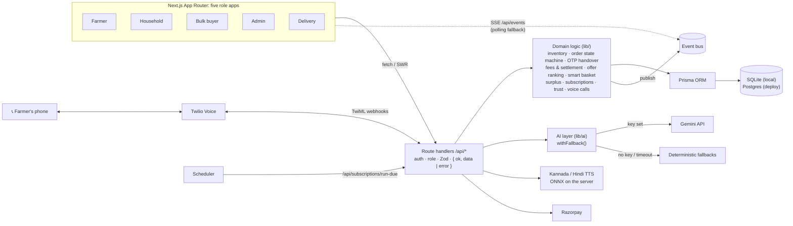

### Order lifecycle

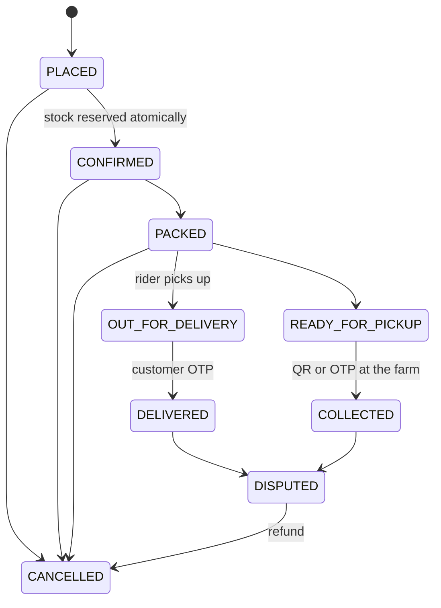

### How the hard parts work

| Concern | Approach | Where |
| --- | --- | --- |
| **No double-selling** | Stock moves only through a conditional `UPDATE … WHERE availableQty >= qty` in a transaction; a whole order reserves or nothing does | `lib/inventory.ts` |
| **Order states** | Explicit transition table; every move is a conditional update on the current status, so racing actions can't skip a step | `lib/orders/state.ts` |
| **Handover OTP** | Stored as an HMAC; 15-minute expiry; 5 attempts counted atomically; handover is idempotent and creates exactly one settlement | `lib/otp.ts`, `lib/delivery/handover.ts` |
| **Who pays what** | Buyer pays subtotal + delivery fee; commission (default 5%) is withheld from the farmer; the farmer covers any courier shortfall but never more than 15% of the order | `lib/fees.ts` |
| **Offer ranking** | Cost, quantity, ETA, visual quality, distance and reliability (30/20/15/15/10/10); ×0.6 if it misses the deadline. The model may only explain, not reorder | `lib/ranking.ts` |
| **Smart basket** | Scores nearby listings per item on price, ETA, freshness and quality, with a bonus for farms that cover several items | `lib/basket.ts` |
| **Surplus rescue** | At risk when sell-through lags or shelf life runs out; rescue offers go to community kitchens, never below 70% of the mandi rate | `lib/surplus.ts` |
| **Order phone calls** | Twilio dials out; each step's TwiML is built from the order; yes/no by rules, other questions by Gemini from the order's facts; per-order HMAC key on webhooks | `lib/voice-call/` |
| **Language by location** | Reverse-geocoded state → Kannada for Karnataka, Hindi for Hindi states; a manual choice always wins; read on the server so pages render in the right language | `lib/geocode.ts`, `lib/i18n/` |
| **Photo check** | Gemini says what the photos show, whether it matches the declared crop, and how fresh it looks; otherwise *not detectable* with the reason. Blur and light only set confidence | `lib/ai/vision/` |
| **Review-driven grades** | The photo score is a prior worth 2–8 reviews; complaints with a confirming photo count 1.5×; grades change only once two buyers agree | `lib/quality/` |
| **Payments** | Razorpay Checkout when keys are set; orders are created only after the signature, amount and capture are confirmed; refunds through Razorpay | `lib/payments/` |
| **Phone verification** | Sign-up codes stored only as an HMAC, 10-minute expiry, 5 tries; every sign-up route requires a verified number | `lib/auth/phone-code.ts` |
| **Trust & safety** | SHA-256 duplicate-photo detection, complaint-rate flags, price outliers; flags only, with humans acting and actions audit-logged | `lib/trust.ts` |

---

## 🧰 Tech stack

| Layer | Technology |
| --- | --- |
| **App** | Next.js 16 (App Router, Turbopack), React 19, TypeScript (strict) |
| **UI** | Tailwind CSS 4, shadcn/ui, Framer Motion, React Three Fiber, Recharts |
| **Data** | Prisma 6: SQLite locally, Postgres (Neon) in production; Zod validation |
| **Auth** | Phone + PIN with SMS verification (MSG91 / Twilio), Google sign-in, Firebase Authentication; jose JWT sessions |
| **AI** | Google Gemini (photo checks, intent fallback, call conversations), with deterministic fallbacks everywhere |
| **Voice** | Browser speech recognition; SYSPIN Kannada/Hindi VITS voices on ONNX Runtime; Twilio Voice + Google WaveNet for phone calls |
| **Payments** | Razorpay Checkout + REST API (no SDK), webhooks, refunds |
| **Realtime** | Server-sent events with a polling fallback; SWR |
| **Quality** | Vitest (489 tests), ESLint with zero warnings, Playwright responsive QA, GitHub Actions CI/CD |
| **Hosting** | Vercel + Neon Postgres; Firestore (optional data copy) |

---

## ⚙️ Setup reference

### What you need

| | Required? | For |
| --- | --- | --- |
| Node.js 20.9+ | ✅ | Everything |
| `DATABASE_URL`, `SESSION_SECRET` | ✅ | `npm run setup` writes both for local use |
| `GEMINI_API_KEY` | Recommended | Photo checks, smarter parsing, order-call conversations ([get a key](https://aistudio.google.com/apikey)) |
| Twilio account (`VOICE_CALLS=on`) | Optional | Order phone calls (a free trial works) |
| `SMS_PROVIDER` | For launch | Sign-up codes by text; `console` shows them on screen for demos |
| Razorpay test keys | Optional | Real checkout in Test Mode |
| Firebase web settings | Optional | Google and email sign-in through Firebase |
| Python 3.10+ (`pip install -r requirements.txt`) | Optional | Building the server-side Kannada/Hindi voices |

Every variable, with what it does, is documented in [`.env.example`](.env.example).

### Scripts

| Command | What it does |
| --- | --- |
| `npm run setup` | First run: creates `.env` with a random secret, applies migrations, seeds the demo |
| `npm run dev` | Development server on http://localhost:3000 |
| `npm run build` / `npm start` | Production build and server |
| `npm test` | Vitest: inventory races, OTP rules, fees, ranking, parsers, payments, voice calls, i18n |
| `npm run lint` / `npm run typecheck` | ESLint (zero warnings) and TypeScript |
| `npm run db:reset` / `npm run db:studio` | Reseed the demo / browse the data |
| `npm run voice:kannada` / `npm run voice:hindi` | Build Sakhi's server-side voices (one-time download) |
| `npm run db:firestore:import` | Dry-run a copy of the data into Firestore; add `-- --write` to import |

### Deploy (Vercel + Postgres)

1. Import the repository at [vercel.com/new](https://vercel.com/new) and connect a **Neon** Postgres database (Storage tab).
2. Set `SESSION_SECRET`, `NEXT_PUBLIC_APP_URL`, `SMS_PROVIDER`, and optionally `GEMINI_API_KEY`, the Twilio, Razorpay and Firebase keys.
3. Deploy. `npm run vercel-build` switches Prisma to Postgres, pushes the schema and builds.
4. Seed once: `npm run db:postgres && npx prisma db push && npm run db:seed` with `DATABASE_URL` pointing at Neon.

CI ([`.github/workflows/ci.yml`](.github/workflows/ci.yml)) lints, typechecks, tests, validates migrations
and builds every pull request; pushes to `main` deploy to Vercel when the `VERCEL_*` secrets are set.

### Project structure

```
app/          routes: one folder per role (farmer, shop, bulk, admin, delivery) + /api
components/   UI by role, plus shell, motion, 3D and landing sections
lib/          domain logic, AI layer, voice calls, auth, i18n (en / hi / kn), payments
prisma/       schema, migrations and the deterministic demo seed
scripts/      setup, Postgres switch, voice-model export, Firestore import, screenshot QA
tests/        Vitest suites (run against a throwaway SQLite database)
docs/         privacy notes and screenshots
```

---

## 🔒 Privacy & security

- PINs are hashed; sign-up codes, handover OTPs and pickup QRs are HMAC-protected and expire.
- Microphone and location are asked once, each with a one-line reason; location sets the language, nearby farms and the delivery area.
- Sakhi uses the browser's own speech recognition; the order call sends Gemini only that one order's facts.
- Firestore denies all client access; PIN hashes never leave the main database.
- Every admin decision (approvals, suspensions, refunds, payouts) is audit-logged.

Details: [docs/assistant-privacy.md](docs/assistant-privacy.md) and the in-app privacy page (`/privacy`).

---

## 🗺️ Roadmap

- [x] Five role apps, voice-first farmer flow, three languages, location-based language
- [x] Order phone calls with language choice and Gemini conversation
- [x] Review-driven quality grades, trust & safety, surplus rescue
- [x] Razorpay checkout and refunds, OTP handover, settlements
- [ ] **Gram Panchayat Saathi dashboard:** assisted sign-up mode, partner codes, incentive ledger
- [ ] **Real payouts** through RazorpayX, and UPI AutoPay for subscriptions
- [ ] **WhatsApp and SMS order updates** alongside the phone call
- [ ] **Server-side Indic speech recognition** for low-end phones
- [ ] **More languages:** Tamil and Telugu next
- [ ] **Cold-chain partners** for milk, eggs and meat in more areas

---

## 👥 Team

Built in 24 hours by [@skypank-coder](https://github.com/skypank-coder), [@RachanaB5](https://github.com/RachanaB5),
[@Charis-E-Shiny](https://github.com/Charis-E-Shiny) and [@disnithaa](https://github.com/disnithaa).

**Acknowledgements:** Kannada and Hindi voices from [SYSPIN](https://huggingface.co/SYSPIN) (IISc Bangalore,
CC BY 4.0); produce photo credits in [public/seed/CREDITS.md](public/seed/CREDITS.md).

<div align="center">

**Every farmer deserves an opportunity. FoodFlow gives them one, in their own language, on any phone.**

</div>
